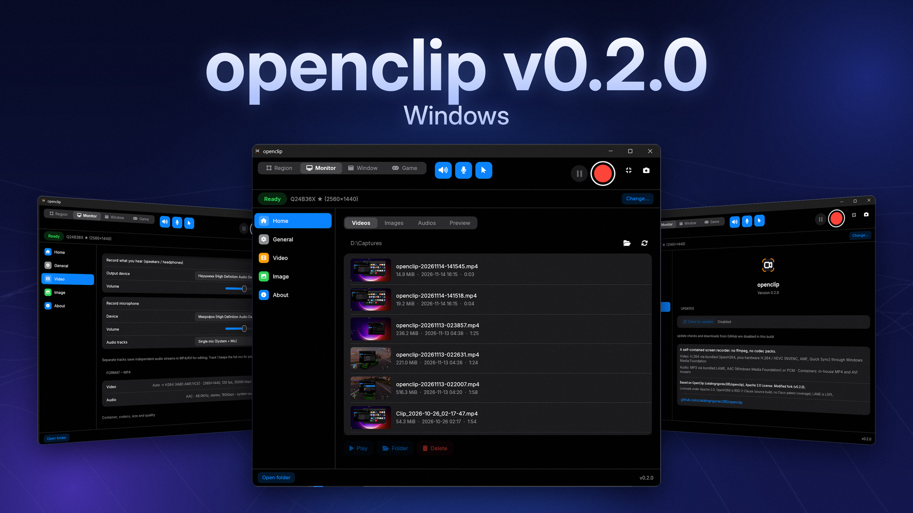
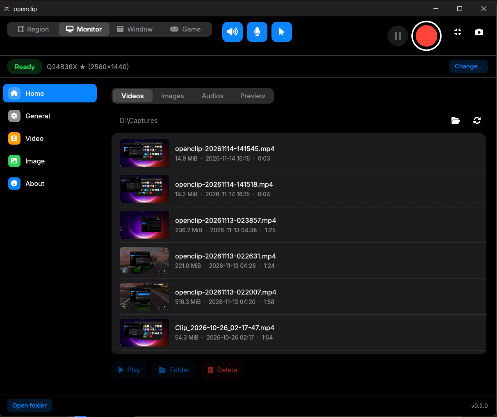
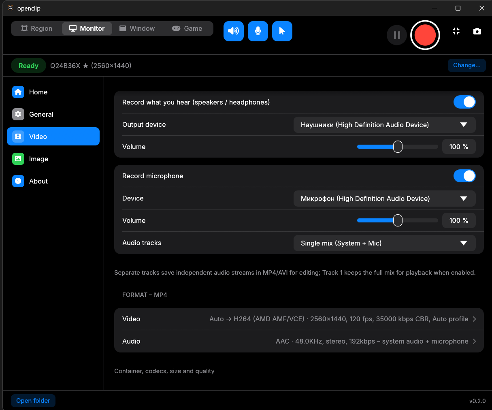
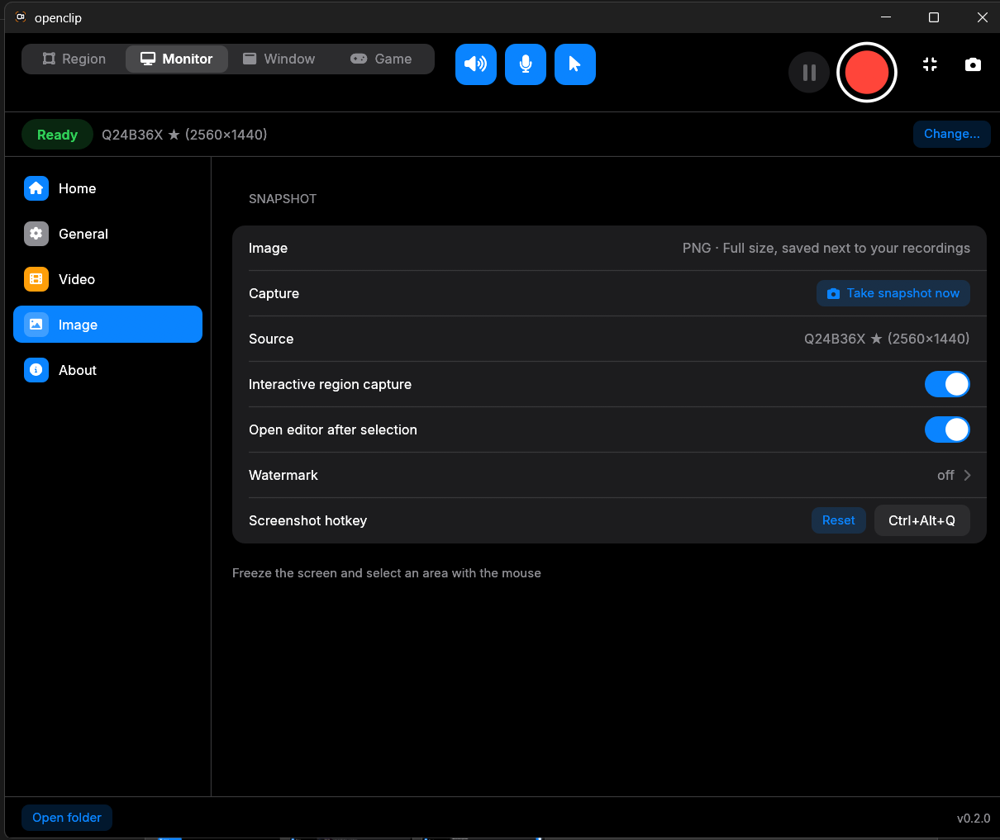
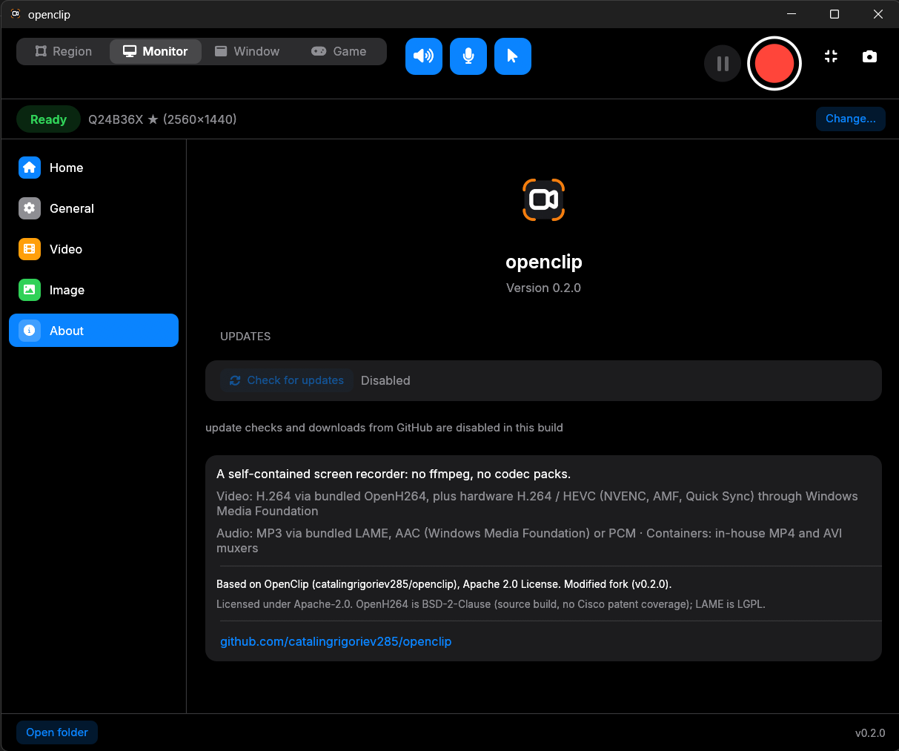

<div align="center">

# openclip <sup>(fork)</sup>

[](https://github.com/By183/openclip/releases/latest)
[](https://github.com/By183/openclip/stargazers)
[](https://github.com/By183/openclip/releases)
[](https://github.com/By183/openclip/actions/workflows/release.yml)
[](LICENSE)

[](https://github.com/By183/openclip/releases/latest)

<br>

[🇬🇧 English](README.md) | [ Русский](README.ru.md)

</div>



> **Fork of [openclip by catalingrigoriev285](https://github.com/catalingrigoriev285/openclip)** (licensed under Apache-2.0).

A lightweight, high-performance screen recording and screenshot application for Windows, written in Rust with an [egui](https://github.com/emilk/egui) interface.

- **Monitor, window, and region capture**: Record an entire display, a specific application window, or a custom cropped rectangular area.
- **Game recording** (Windows 64-bit): Captures frames directly from DirectX 11, DirectX 12, or OpenGL swap-chain back buffers for minimal performance overhead in exclusive fullscreen, complete with an in-game FPS overlay (**green** when armed, **red** when recording).
- **System audio and microphone**: Captures loopback desktop sound and input microphone audio with independent gain controls (up to 200%) and optional separate audio tracks.
- **Live preview**: Real-time rendering of what is currently being recorded.
- **Standard container formats**: Produces standard MP4 and AVI 2.0 (OpenDML) files playable everywhere without transcoding.
- **Hardware GPU encoding**: Windows Media Foundation hardware encoders (AMD AMF verified; NVIDIA NVENC and Intel Quick Sync supported in code) plus bundled CPU fallback encoders.
- **No external runtime dependencies**: No ffmpeg, no external DLLs, and no codec packs required. Bundled H.264 ([OpenH264](https://www.openh264.org/)) and MP3 ([LAME](https://lame.sourceforge.io/)) encoders are built into the binary.

---

## What's Different in This Fork

### Added
* **Interactive Screenshot Editor (`Ctrl+Alt+Q`)**: Instant freeze-frame screen capture overlay with interactive vector annotations — rectangle, arrow, straight line, freehand pen, highlighter/marker, text labels, and pixelate blur. Supports selection move/resize, Undo (`Ctrl+Z`), direct save to PNG, and instant copy to clipboard.
* **Global Recording Hotkey (`Ctrl+Alt+R`) with Sound Feedback**: Toggle recording from anywhere with audio cue beeps that are isolated from the recorded audio stream. Configurable feedback modes: *Off*, *Hotkey only*, or *Always*.
* **Zero-Readback GPU Color Conversion**: Dedicated Direct3D 11 Video Processor (`ID3D11VideoProcessor`) converting capture textures from `BGRA` to `NV12` entirely within GPU VRAM, feeding Media Foundation hardware encoders (AMD AMF verified) with under 2% CPU utilization.
* **Color Conversion Mode Setting**: User-selectable color conversion pipeline: *Auto* (prefers GPU Video Processor, falls back to CPU), *GPU* (enforces hardware pipeline), or *CPU* (SIMD YUV fallback).
* **Adaptive Frame Clock ("Auto" FPS)**: Dynamically aligns frame pacing to display refresh rate (vsync grid) and suppresses redundant encoding during static desktop scenes to save disk space and power.
* **Audio Device & Track Enhancements**: Select specific playback loopback and microphone input devices, adjust gain up to 200%, or record system audio and microphone into separate audio tracks.
* **Hardware GPU Decoding in Built-in Player**: Video playback acceleration with Direct3D 11 NV12-to-RGBA hardware color conversion.
* **Ukrainian Language Localization**: Complete Ukrainian (`uk`) UI translation alongside supplemented English, Romanian, and Russian localizations.
* **Diagnostic Logging & Automated Tests**: Comprehensive logging to `openclip.log` and a suite of 178 integration tests covering container muxers, audio synchronization, and hotkey sequencing.

### Improved
* **High-Fidelity Audio Resampling**: Upgraded to a 16-tap Kaiser-windowed sinc resampler (`KaiserSincResampler`, $\beta=6.0$), eliminating aliasing distortion between 44.1 kHz and 48 kHz sample rates.
* **Higher Bitrate Limits**: Constant Bitrate (CBR) settings up to 100,000 kbps (100 Mbps) for pristine high-motion recording.
* **Expanded Framerate Presets**: Presets up to 144 FPS for high-refresh-rate gaming monitors.

### Removed
* **Network & Auto-Update Code**: Removed GitHub update checker, automatic background downloader, and online sidecar repair routines. OpenClip contains **0 network calls** and operates entirely offline.

### Unchanged
* Core capture backends for Monitor, Window, Region, and Game (64-bit).
* Standard output containers: MP4 and AVI 2.0.
* Mouse click rings, cursor highlight, and watermark overlay (note: mouse effects and watermarks route frames through the CPU staging path).

---

## Screenshots

| Main Dashboard | Video Settings |
|:---:|:---:|
| <br><sub>Source selection, input toggles, and live preview</sub> | <br><sub>Encoders, resolution, framerate, and GPU color conversion</sub> |
| **Image & Screenshot Settings** | **About OpenClip** |
| <br><sub>Screenshot editor preferences and file naming</sub> | <br><sub>Hardware detection, version info, and license details</sub> |

---

## Building

OpenClip is built specifically for **Windows** (Windows 10 version 1903+ or Windows 11).

### Requirements
* **Rust**: Toolchain 1.85+ (Rust 2024 edition).
* **C/C++ Build Tools**: Visual Studio Build Tools with C++ workload (MSVC `cl.exe` and `link.exe`).
* **NASM** *(optional)*: Install [NASM](https://www.nasm.us/) in your `PATH` to compile OpenH264 with optimized SIMD assembly kernels.

### Compile
```sh
cargo build --release
.\target\release\openclip.exe
```

The game capture hook DLL (`openclip_hook64.dll`) is built in the same workspace:
```sh
cargo build --release --workspace
```

---

## Usage

1. **Select Source**: Choose **Monitor** (full screen), **Window** (individual app), **Region** (drag a rectangle on screen), or **Game** (direct hook into 64-bit DirectX 11/12 or OpenGL titles).
2. **Configure Audio**: Toggle desktop sound (loopback) and microphone. Select specific audio devices or boost gain in the audio settings dialog.
3. **Record**:
   - Click the **Record** button in the UI, or press **`Ctrl+Alt+R`** from any application.
   - Distinct audio beeps confirm start and stop.
   - When finished, press **`Ctrl+Alt+R`** again or click **Stop**.
4. **Take Screenshots**:
   - Click the camera icon or press **`Ctrl+Alt+Q`** to freeze the screen.
   - Drag to select an area, apply vector annotations (arrows, text, blur), and press `Enter` (or click Save/Copy).
5. **Manage Recordings**: View recorded videos in the built-in library, inspect diagnostics, or play back clips directly with GPU acceleration.

---

## Format Settings

| Parameter | Options | Description |
|---|---|---|
| **Container** | MP4, AVI | MP4 produces compact, widely compatible files; AVI 2.0 (OpenDML) is index-backed. |
| **Video Encoder** | Hardware (MF), OpenH264 | Hardware uses GPU MFT (AMD AMF, NVENC, Quick Sync); OpenH264 runs on CPU. |
| **Color Conversion** | Auto, GPU, CPU | **Auto** prefers Direct3D 11 Video Processor; **GPU** enforces VRAM conversion; **CPU** uses SIMD YUV. |
| **Audio Encoder** | AAC (MF), MP3 (LAME), PCM | Media Foundation AAC or bundled LAME MP3 for compressed audio; uncompressed 16-bit PCM for AVI. |
| **Bitrate** | 1,000 to 100,000 kbps | Constant bitrate (CBR) targeting from lightweight clips to high-bitrate archival. |
| **Framerate** | Auto, 24, 30, 60, 120, 144 | **Auto** synchronizes with display refresh rate and suppresses duplicate idle frames. |

---

## Mouse Effects

* **Cursor Highlight & Click Rings**: Highlight cursor position and visualize left/right mouse clicks.
* **Watermark Overlay**: Stamp custom text or timestamp onto video frames.
* *Note*: Because cursor effects and watermarks modify pixels directly in system memory, enabling them switches the video pipeline to the CPU staging path.

---

## How It Works

```
[Windows.Graphics.Capture]
          │
     (GPU Texture)
          │
          ├──▶ [GPU Path] ──▶ ID3D11VideoProcessor (BGRA ➔ NV12) ──▶ Media Foundation Hardware MFT (AMF/NVENC/QSV) ──┐
          │                                                                                                        │
          └──▶ [CPU Path] ──▶ Staging Copy ──▶ SIMD YUV Convert ──▶ OpenH264 Software Encoder ────────────────────┤
                                                                                                                  ▼
[Audio WASAPI Loopback / Mic] ──▶ Kaiser Sinc Resampler ──▶ Audio Mixer ──▶ Media Foundation AAC / LAME MP3 ──▶ MP4 / AVI Muxer ──▶ File
```

* **Capture** (`src/capture`): Windows Graphics Capture (WGC) provides hardware-accelerated desktop textures. In the GPU path, textures stay in VRAM. In the CPU fallback path, frames are read back through double-buffered staging textures without runtime memory allocations.
* **GPU Video Processing** (`src/video/d3d11_vp.rs`): Uses Direct3D 11 Video Processor interfaces to execute hardware color conversion (`DXGI_FORMAT_B8G8R8A8_UNORM` $\rightarrow$ `DXGI_FORMAT_NV12`) directly on the GPU.
* **Video Encoders** (`src/video`): Media Foundation Transform (MFT) interfaces stream NV12 buffers into hardware ASICs (tested on AMD AMF) or bundled CPU OpenH264.
* **Audio Engine** (`src/audio`): WASAPI loopback and microphone streams are aligned to the recording timeline. Sample rate conversion uses a 16-tap Kaiser sinc filter ($\beta=6.0$) to avoid aliasing artifacts.
* **Muxers** (`src/mux`): Native MP4 writer (64-bit `mdat` and `moov`) and OpenDML AVI writer (`RIFF`/`AVIX` chunks with super-indexing).
* **Snipping Tool** (`src/ui/snipping.rs`): Captures a pristine desktop freeze-frame, paints non-destructive vector overlays, and allows instant clipping.

---

## Limitations

* **Windows Only**: Designed specifically for the Windows graphics and audio subsystem (Direct3D 11, DXGI, Media Foundation, WASAPI).
* **Hardware Compatibility**: GPU video processing and AMF encoding are verified on AMD Radeon RX 6600. NVIDIA NVENC and Intel Quick Sync pipelines are implemented via standard Media Foundation transforms but have not been physically verified on those hardware architectures.
* **Crash Resilience of MP4**: Standard MP4 files write the indexing metadata (`moov` atom) when recording stops cleanly. Sudden process termination or power loss will leave an unfinalized MP4 file unplayable.
* **Audio Device Disconnection**: If an active audio device is unplugged during recording, that audio stream terminates; dynamic re-enumeration mid-recording is not currently supported.
* **Game Capture**: Hooking is supported for 64-bit DirectX 11, DirectX 12, and OpenGL applications. It does not bypass aggressive third-party anti-cheat systems (e.g., Easy Anti-Cheat, BattlEye, Riot Vanguard).
* **Unsigned Executable**: The binary is not signed with an expensive EV code signing certificate; Windows SmartScreen may show an unknown publisher warning upon first launch.

---

## Privacy

* **Zero Network Traffic**: OpenClip contains no telemetry, analytics, cloud synchronization, or external HTTP requests.
* **Zero Keystroke Logging**: The low-level keyboard hook listens exclusively for configured global hotkeys (`Ctrl+Alt+R` and `Ctrl+Alt+Q`). No other keys or user input are ever inspected, logged, or recorded.

---

## Updates

Update checks and auto-installation were removed from this fork. Updates come exclusively via manual releases on GitHub:
👉 [OpenClip GitHub Releases](https://github.com/By183/openclip/releases)

---

## Licensing Notes

OpenClip is released under the **Apache License, Version 2.0** (see [LICENSE](LICENSE)).

Third-party bundled libraries and assets:
* **OpenH264**: Cisco Systems, BSD 2-Clause License.
* **LAME**: The LAME Project, LGPL.
* **Inter Font**: Rasmus Andersson, SIL Open Font License 1.1.
* **Font Awesome Free**: Fonticons, Inc., SIL OFL 1.1 font and CC BY 4.0 icons.
* See [NOTICE](NOTICE) for complete third-party notices and licenses.

---

## Credits

Based on the original [openclip](https://github.com/catalingrigoriev285/openclip) created by [Catalin Grigoriev](https://github.com/catalingrigoriev285).

---

## Roadmap

* [ ] **Fragmented MP4 (`fMP4`)**: Real-time progressive fragment muxing to make recordings crash-resilient against power loss.
* [ ] **GPU Cursor Overlays**: Render cursor highlights and click effects directly in D3D11 shaders without falling back to CPU memory.
* [ ] **Dynamic Audio Device Recovery**: Hot-reconnection of audio endpoints if a USB microphone or headset is unplugged during a session.
