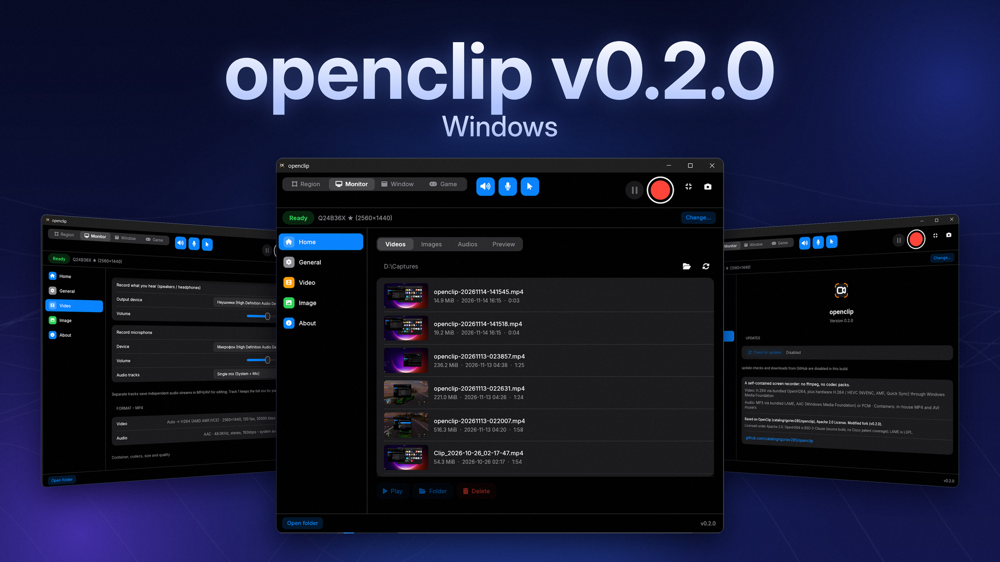
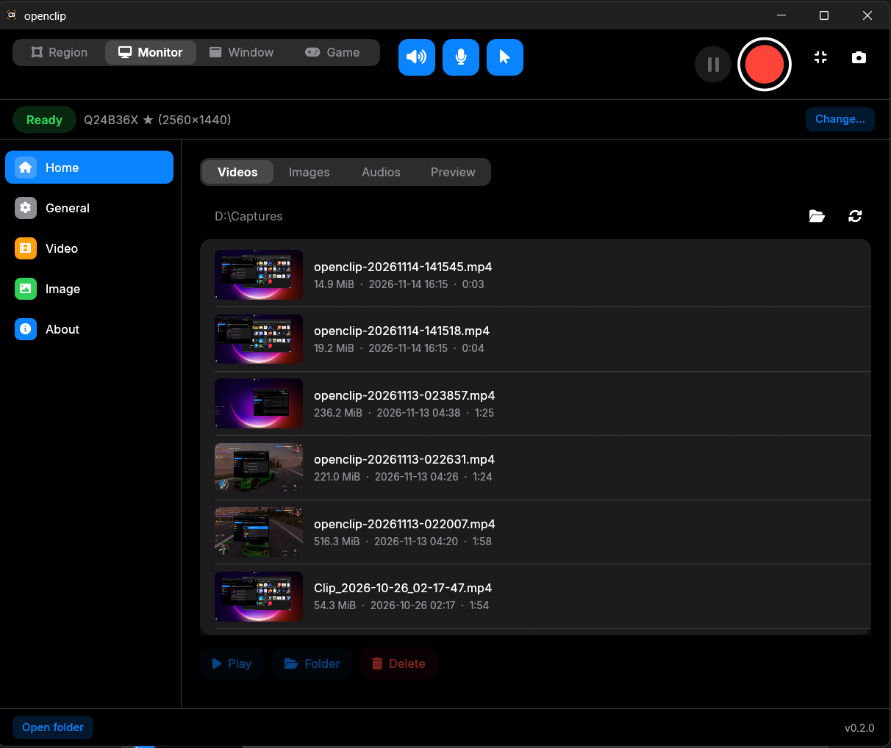
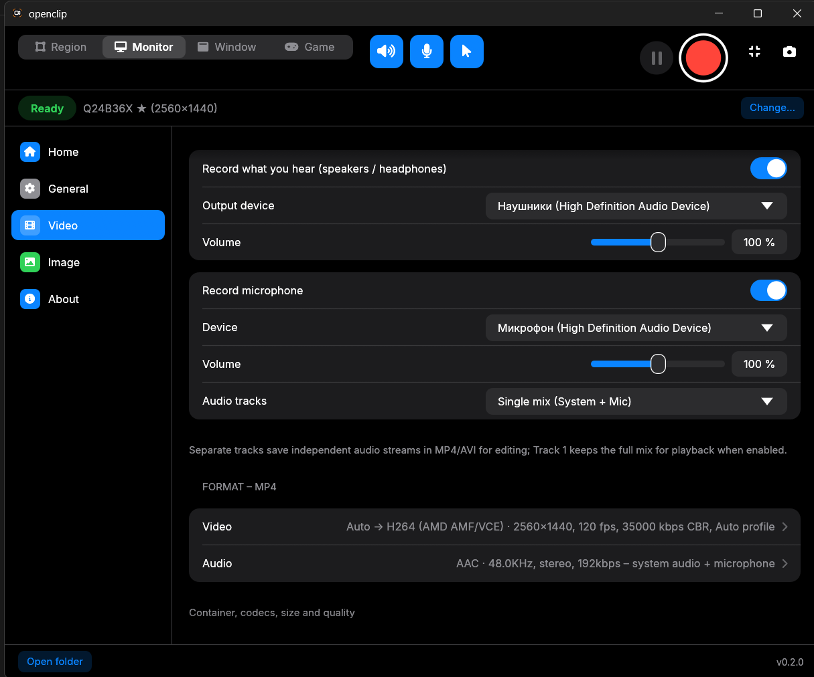
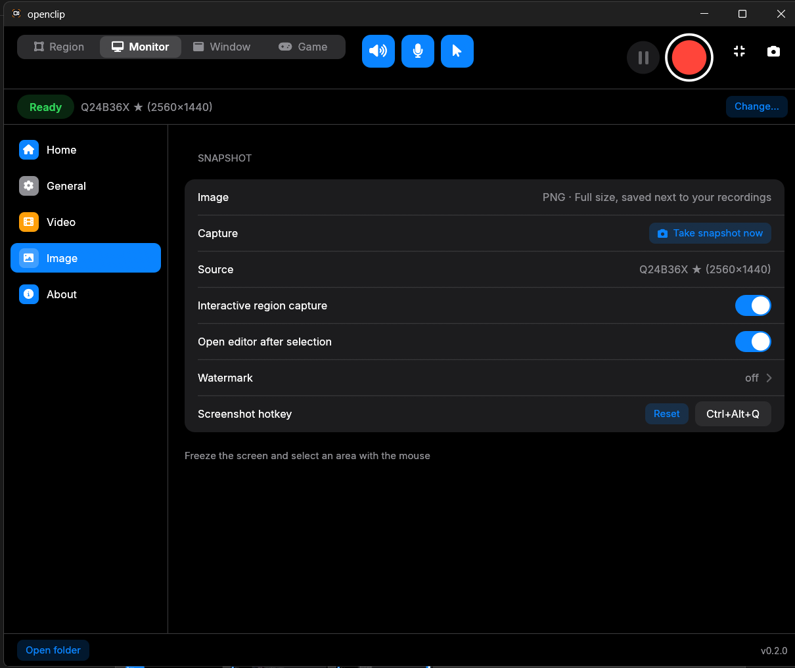
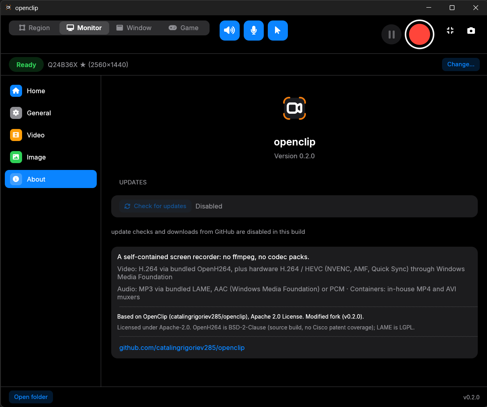

<div align="center">

# openclip <sup>(форк)</sup>

[](https://github.com/By183/openclip/releases/latest)
[](https://github.com/By183/openclip/stargazers)
[](https://github.com/By183/openclip/releases)
[](https://github.com/By183/openclip/actions/workflows/release.yml)
[](LICENSE)

[](https://github.com/By183/openclip/releases/latest)

<br>

[🇬🇧 English](README.md) | [ Русский](README.ru.md)

</div>



> **Форк проекта [openclip от catalingrigoriev285](https://github.com/catalingrigoriev285/openclip)** (лицензия Apache-2.0).

Компактная, быстрая программа для записи экрана и создания скриншотов под Windows, написанная на Rust с графическим интерфейсом на базе [egui](https://github.com/emilk/egui).

- **Запись монитора, окна или области**: запись рабочего стола целиком, отдельного окна приложения или прямоугольной области произвольного размера.
- **Запись игр** (Windows 64-бит): прямой перехват кадров из бэкбуфера DirectX 11, DirectX 12 или OpenGL через встроенный хук без лишней нагрузки на игру в полноэкранном режиме, со встроенным счетчиком FPS (**зелёный** в ожидании, **красный** во время записи).
- **Системный звук и микрофон**: захват звука динамиков (loopback) и микрофона с независимой регулировкой усиления до 200 % и возможностью записи в раздельные дорожки.
- **Живой предпросмотр**: отображение записываемой картинки в реальном времени прямо в интерфейсе.
- **Стандартные форматы**: сохранение в файлы MP4 и AVI 2.0 (OpenDML), которые сразу открываются в любых плеерах и видеоредакторах.
- **Аппаратное GPU-кодирование**: поддержка аппаратных кодировщиков Windows Media Foundation (AMD AMF проверен; код для NVIDIA NVENC и Intel Quick Sync включён) и встроенных программных кодировщиков.
- **Без внешних зависимостей во время работы**: не требует ffmpeg, внешних DLL или кодек-паков. Видеокодек H.264 ([OpenH264](https://www.openh264.org/)) и аудиокодек MP3 ([LAME](https://lame.sourceforge.io/)) встроены прямо в исполняемый файл.

---

## Что изменилось в этом форке

### Добавлено
* **Интерактивный редактор скриншотов (`Ctrl+Alt+Q`)**: мгновенная «заморозка» экрана с оверлеем для выделения области и набором векторных инструментов — прямоугольник, стрелка, линия, перо, маркер/выделитель, текст и размытие (пикселизация). Поддерживает перемещение и изменение размера выделения, отмену действий (`Ctrl+Z`), сохранение в PNG и быстрое копирование в буфер обмена.
* **Глобальная горячая клавиша записи (`Ctrl+Alt+R`) со звуковыми сигналами**: включение и остановка записи из любого приложения с ненавязчивыми звуковыми сигналами, которые не попадают в итоговую аудиодорожку. Настраиваемые режимы: *Отключено*, *Только по хоткею* или *Всегда*.
* **GPU-конвертация цвета без копирования в память**: модуль Direct3D 11 Video Processor (`ID3D11VideoProcessor`) преобразует текстуры из `BGRA` в `NV12` целиком в видеопамяти и передает их в аппаратный кодировщик Media Foundation (AMD AMF протестирован), снижая нагрузку на CPU до <2 %.
* **Выбор режима конвертации цвета**: пользовательская настройка в параметрах видео: *Авто* (предпочитает GPU Video Processor с откатом на CPU), *GPU* (принудительно через видеокарту) или *CPU* (программная конвертация через SIMD YUV).
* **Режим «Авто» FPS и адаптивная сетка кадров**: подстраивает такт кадров под частоту обновления монитора (сетка vsync) и подавляет кодирование лишних одинаковых кадров на статичном экране для экономии места и ресурсов.
* **Расширенные настройки звука**: выбор конкретных аудиоустройств вывода и микрофона, регулировка громкости до 200 % и режим записи в раздельные аудиодорожки.
* **Аппаратное GPU-декодирование во встроенном плеере**: ускоренное воспроизведение записанных видеороликов через D3D11-конвертацию NV12 в RGBA.
* **Украинская локализация**: добавлен украинский язык интерфейса (`uk`), а также дополнены переводы на английский, румынский и русский языки.
* **Диагностический лог и тесты**: запись подробной отладочной информации в файл `openclip.log` и набор из 178 интеграционных тестов для проверки муксеров, синхронизации звука и горячих клавиш.

### Улучшено
* **Качественный sinc-ресемплер звука**: переход на 16-отводный оконный sinc-фильтр Кайзера (`KaiserSincResampler`, $\beta=6.0$), устраняющий искажения дискретизации (элайасинг) между частотами 44.1 кГц и 48 кГц.
* **Увеличенные лимиты битрейта**: битрейт постоянного качества (CBR) расширен до 100 000 кбит/с (100 Мбит/с) для записи динамичных сцен без артефактов сжатия.
* **Предустановки частоты кадров**: добавлены пресеты вплоть до 144 кадров/с для мониторов с высокой частотой обновления.

### Удалено
* **Сетевой код и модуль автообновления**: полностью вырезаны проверка версий на GitHub, фоновое скачивание и сетевое восстановление библиотек. В программе **0 сетевых вызовов**, она работает строго офлайн.

### Без изменений
* Базовые режимы захвата: Монитор, Окно, Область, Игра (64-бит).
* Форматы контейнеров: MP4 и AVI 2.0.
* Эффекты мыши (подсветка, круги кликов) и водяной знак (включение эффектов курсора или водяного знака переводит обработку на CPU-путь).

---

## Скриншоты программы

| Главный экран | Настройки видео |
|:---:|:---:|
| <br><sub>Выбор источника, переключатели звука и живой предпросмотр</sub> | <br><sub>Кодировщики, разрешение, частота кадров и GPU-конвертация</sub> |
| **Параметры снимков экрана** | **О программе** |
| <br><sub>Настройки редактора скриншотов и правила именования</sub> | <br><sub>Определение оборудования, версия и сведения о лицензиях</sub> |

---

## Сборка из исходников

OpenClip разработан для операционной системы **Windows** (Windows 10 версии 1903+ или Windows 11).

### Требования
* **Rust**: компилятор версии 1.85+ (редакция Rust 2024).
* **Инструменты сборки C/C++**: Visual Studio Build Tools с компонентами C++ (компилятор MSVC `cl.exe` и линковщик `link.exe`).
* **NASM** *(необязательно)*: установите [NASM](https://www.nasm.us/) и добавьте его в переменную `PATH` для сборки оптимизированных ассемблерных ядер кодека OpenH264.

### Команды сборки
```sh
cargo build --release
.\target\release\openclip.exe
```

Сборка библиотеки игрового хука (`openclip_hook64.dll`) выполняется в том же рабочем пространстве:
```sh
cargo build --release --workspace
```

---

## Использование

1. **Выберите источник**: выберите **Монитор** (весь экран), **Окно** (конкретная программа), **Область** (выделение рамкой) или **Игра** (захват из полноэкранных 64-битных игр на базе DirectX 11/12 или OpenGL).
2. **Настройте аудио**: включите системный звук и/или микрофон. При необходимости выберите нужные звуковые карты и отрегулируйте громкость в параметрах звука.
3. **Запись**:
   - Нажмите кнопку **Запись** в окне программы или воспользуйтесь сочетанием **`Ctrl+Alt+R`** в любом окне.
   - Звуковой сигнал подтвердит начало записи.
   - Для завершения снова нажмите **`Ctrl+Alt+R`** или кнопку **Стоп**.
4. **Скриншоты**:
   - Нажмите иконку камеры или нажмите **`Ctrl+Alt+Q`** для заморозки экрана.
   - Выделите область, нанесите стрелки, текст или размытие и нажмите `Enter` (либо кнопки сохранения/копирования).
5. **Просмотр записей**: просматривайте готовые ролики во встроенной библиотеке или воспроизводите их встроенным плеером с аппаратным ускорением.

---

## Настройки формата

| Параметр | Варианты | Описание |
|---|---|---|
| **Контейнер** | MP4, AVI | MP4 — компактный и универсальный формат; AVI 2.0 (OpenDML) с индексными блоками. |
| **Видеокодек** | Аппаратный (MF), OpenH264 | Аппаратный использует GPU MFT (AMD AMF, NVENC, Quick Sync); OpenH264 работает на CPU. |
| **Конвертация цвета** | Авто, GPU, CPU | **Авто** отдает предпочтение Direct3D 11 Video Processor; **GPU** форсирует видеопамять; **CPU** использует SIMD YUV. |
| **Аудиокодек** | AAC (MF), MP3 (LAME), PCM | Media Foundation AAC или LAME MP3 для сжатого звука; несжатый 16-битный PCM для AVI. |
| **Битрейт** | от 1 000 до 100 000 кбит/с | Постоянный битрейт (CBR) для баланса между размером файла и максимальной четкостью. |
| **Частота кадров** | Авто, 24, 30, 60, 120, 144 | **Авто** подстраивается под герцовку монитора и исключает дублирующиеся кадры. |

---

## Эффекты мыши

* **Подсветка курсора и круги кликов**: подсветка положения мыши и визуализация нажатий левой/правой кнопки.
* **Водяной знак**: наложение пользовательского текста или временной метки поверх видео.
* *Обратите внимание*: эффекты курсора и водяной знак изменяют пиксели напрямую в системной памяти, поэтому их включение переводит конвейер записи на CPU-путь.

---

## Как это устроено

```
[Windows.Graphics.Capture]
          │
    (Текстура GPU)
          │
          ├──▶ [GPU-путь] ──▶ ID3D11VideoProcessor (BGRA ➔ NV12) ──▶ Аппаратный MFT (AMF / NVENC / QSV) ──────────┐
          │                                                                                                        │
          └──▶ [CPU-путь] ──▶ Staging-текстура ──▶ Преобразование SIMD YUV ──▶ Программный кодек OpenH264 ───────┤
                                                                                                                   ▼
[WASAPI Loopback / Микрофон] ──▶ Sinc-ресемплер Кайзера ──▶ Звуковой микшер ──▶ Кодек AAC (MF) / MP3 (LAME) ──▶ Муксер MP4 / AVI ──▶ Файл
```

* **Захват** (`src/capture`): Windows Graphics Capture (WGC) захватывает кадры напрямую с GPU. В GPU-пути текстуры остаются в VRAM без лишних копирований. В резервном CPU-пути используется двойная буферизация staging-текстур без постоянных выделений памяти.
* **Видеопроцессор GPU** (`src/video/d3d11_vp.rs`): Direct3D 11 Video Processor выполняет аппаратное преобразование цветовых пространств (`DXGI_FORMAT_B8G8R8A8_UNORM` $\rightarrow$ `DXGI_FORMAT_NV12`) силами видеочипа.
* **Кодирование видео** (`src/video`): интерфейсы Media Foundation Transform (MFT) передают буферы в аппаратные блоки видеокарты (проверено на AMD AMF) либо во встроенный OpenH264.
* **Звуковой движок** (`src/audio`): потоки системного звука и микрофона синхронизируются с таймлайном записи. Преобразование частоты дискретизации выполняется 16-отводным sinc-фильтром Кайзера ($\beta=6.0$), исключающим искажения.
* **Муксеры** (`src/mux`): собственная реализация потокового MP4 (64-битные `mdat` и `moov`) и OpenDML AVI (блоки `RIFF`/`AVIX` со сверхиндексами).
* **Скриншоты** (`src/ui/snipping.rs`): захват застывшего экрана высокого разрешения с векторным рисованием и быстрым экспортом.

---

## Ограничения

* **Только Windows**: архитектура глубоко завязана на подсистемы Windows (Direct3D 11, DXGI, Media Foundation, WASAPI).
* **Аппаратная поддержка**: GPU-конвертация и кодирование через AMF полностью протестированы на AMD Radeon RX 6600. Код для NVIDIA NVENC и Intel Quick Sync реализован по стандарту Media Foundation, но аппаратные тесты на соответствующих видеокартах не проводились.
* **Отказоустойчивость MP4**: стандартный контейнер MP4 записывает индексную таблицу (`moov`-атом) только при корректной остановке записи. При аварийном завершении процесса или отключении питания незавершенный MP4-файл не откроется.
* **Отключение аудиоустройств**: при физическом отключении микрофона или наушников во время записи соответствующий звуковой поток останавливается (динамическое переподключение «на лету» не поддерживается).
* **Захват игр**: перехват работает только в 64-битных играх на DirectX 11, DirectX 12 и OpenGL. Не работает в играх с агрессивными античитами (Easy Anti-Cheat, BattlEye, Vanguard).
* **Неподписанный бинарник**: файл не подписан платным сертификатом разработчика; при первом запуске фильтр Windows SmartScreen может вывести стандартное предупреждение о неизвестном издателе.

---

## Конфиденциальность

* **Ноль сетевых запросов**: в OpenClip отсутствуют сбор телеметрии, аналитика, фоновые опросы серверов и облачные функции.
* **Безопасность клавиатуры**: низкоуровневый перехватчик клавиатуры отслеживает исключительно назначенные комбинации клавиш (`Ctrl+Alt+R` и `Ctrl+Alt+Q`). Нажатия других клавиш никогда не считываются, не перехватываются и не сохраняются.

---

## Обновления

Проверка обновлений и автоматическая установка были удалены из этого форка. Новые версии публикуются в виде релизов на GitHub:
👉 [Релизы OpenClip на GitHub](https://github.com/By183/openclip/releases)

---

## Лицензия

OpenClip распространяется под лицензией **Apache License, Version 2.0** (см. [LICENSE](LICENSE)).

Сторонние компоненты:
* **OpenH264**: Cisco Systems, лицензия BSD 2-Clause.
* **LAME**: проект LAME, лицензия LGPL.
* **Шрифт Inter**: Rasmus Andersson, лицензия SIL Open Font License 1.1.
* **Font Awesome Free**: Fonticons, Inc., лицензии SIL OFL 1.1 и CC BY 4.0.
* Полный перечень сторонних компонентов приведен в файле [NOTICE](NOTICE).

---

## Благодарности

Проект основан на оригинальном коде [openclip](https://github.com/catalingrigoriev285/openclip) от [Catalin Grigoriev](https://github.com/catalingrigoriev285).

---

## Планы на будущее

* [ ] **Фрагментированный MP4 (`fMP4`)**: потоковая запись фрагментов в реальном времени для защиты файлов от повреждения при сбоях питания.
* [ ] **Отрисовка курсора на GPU**: наложение эффектов кликов и курсора прямо через шейдеры D3D11 без переключения на CPU-путь.
* [ ] **Динамическое восстановление звука**: автоматическое переподключение звуковых устройств при их повторном включении во время записи.
